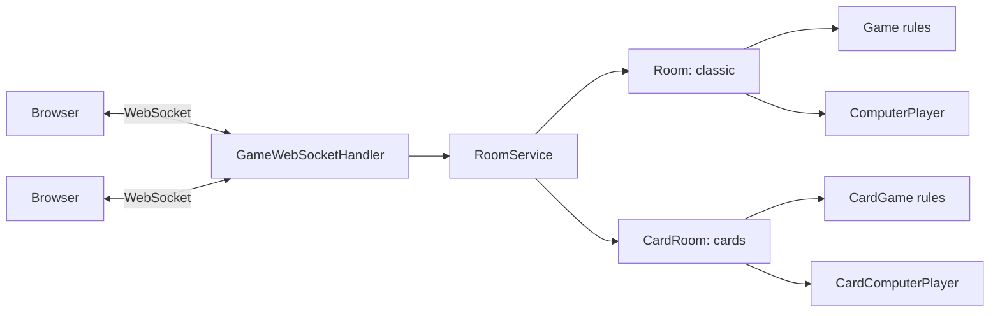

# Four in a Row – Online

[](https://github.com/barakes/FourInARow/actions/workflows/ci.yml)

A real-time multiplayer four-in-a-row game with two modes, a computer opponent at three levels,
and private rooms to play with a friend. Built for children: no sign-up, big buttons, Hebrew interface.

**Play it:** https://fourinarow-990e.onrender.com
*(Free hosting: the first visit after a period of inactivity can take about 2 minutes while the server wakes up.)*

---

## Game modes

**Classic** – discs fall to the bottom of the chosen column. Four in a row wins.

**Cards** – an original card version:
- The board (6×6, or 7×7 with a free cell in the middle) shows pictures, each on two cells. The layout is shuffled for every game, and two equal pictures never touch.
- Each player holds 3 hidden cards. Playing a picture card places a disc on a matching empty cell, then a new card is drawn.
- **Wild** cards place a disc on any empty cell; **remove** cards take away one of the opponent's discs.
- The free cell counts for both players. Four in a row wins.

## Features

- **Play against the computer** at three difficulty levels, in both modes.
- **Play with a friend** in real time: open a room and share a 5-character code (no look-alike characters such as 0/O or 1/I).
- **Server-authoritative**: the browser only *requests* moves; the server validates every move against the rules, so a modified client can't cheat.
- **Hidden information stays hidden**: in the card game, each player receives only their own hand. Messages that contain a hand are built separately for each player.
- **Accessible**: discs differ by symbol as well as color.

## Tech stack

| Area | Technology |
|---|---|
| Language | Java 25 |
| Framework | Spring Boot 4.1 (Web MVC, WebSocket) |
| Real-time | Raw WebSocket with a small JSON protocol |
| Client | Plain HTML, CSS and JavaScript (no framework) |
| Tests | JUnit 6, AssertJ |
| CI/CD | GitHub Actions, Docker, Render |

## Architecture



The game rules (`game`, `cards`) are plain Java with no framework code, so they are fast to test and are shared by the server and the computer players.

## Design decisions

- **Minimax with alpha-beta pruning** (classic mode). The computer looks up to 7 moves ahead using the negamax form of minimax. Alpha-beta pruning and center-first move ordering cut most of the search tree, so even the hardest level answers in a few milliseconds.
- **A different AI for hidden information** (card mode). The computer can't know the opponent's cards or the next draw, so instead of looking ahead it scores every legal move with a board evaluation that weighs blocking threats above building its own lines, and saves special cards for when they matter.
- **Rooms behind an interface.** `GameRoom` lets the room service handle both game modes without knowing which one is played inside.
- **Thread safety.** Moves from two players can arrive at the same moment on different threads: game and room methods are synchronized, room-level locks keep different games from waiting on each other, and a `ConcurrentWebSocketSessionDecorator` makes sending safe from several threads.
- **Errors never leak internals.** Expected problems (a full column, a wrong room code) are sent to the player; unexpected errors are logged and the player gets a generic message.
- **Input hardening.** Message size limit, nicknames reduced to letters/digits/spaces, secure random room codes, and WebSocket connections accepted only from the same origin (prevents cross-site WebSocket hijacking).
- **Testable by design.** Rooms talk to a `Connection` interface, so tests use a fake connection that records messages; random choices take a seeded `Random`, so tests are repeatable.

## Running locally

Requirements: Java 25.

```bash
./mvnw spring-boot:run
```

Then open http://localhost:8080.

## Tests

```bash
./mvnw test
```

65 tests: win detection in every direction, draws and illegal moves; the computer players (takes wins, blocks threats, uses special cards, stronger levels beat weaker ones); the card game rules (board layout, deck, hidden hands, the free cell, the "no playable card" rule, hundreds of random full games); and rooms (joining, leaving, and that each player only ever receives their own cards).

## Credits

Pictures: [Microsoft Fluent Emoji](https://github.com/microsoft/fluentui-emoji), MIT license (see `src/main/resources/static/images/LICENSE-fluentui-emoji.txt`).

## Roadmap

- Play against a random online opponent, with ratings
- Rematch button
- Reconnecting to a game after a dropped connection