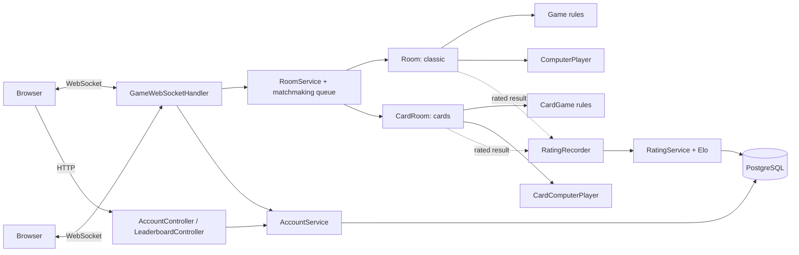

Four in a Row – Online

A real-time multiplayer four-in-a-row game with two modes, a computer opponent at three levels,
private rooms to play with a friend, and rated games against random online opponents with an Elo leaderboard.
Built for children: no sign-up needed for casual play, big buttons, Hebrew interface.
Play it: https://fourinarow-990e.onrender.com
(Free hosting: the first visit after a period of inactivity can take about 2 minutes while the server wakes up.)
---
Game modes
Classic – discs fall to the bottom of the chosen column. Four in a row wins.
Cards – an original card version:
The board (6×6, or 7×7 with a free cell in the middle) shows pictures, each on two cells. The layout is shuffled for every game, and two equal pictures never touch.
Each player holds 3 hidden cards. Playing a picture card places a disc on a matching empty cell, then a new card is drawn.
Wild cards place a disc on any empty cell; remove cards take away one of the opponent's discs.
The free cell counts for both players. Four in a row wins.
Features
Play against the computer at three difficulty levels, in both modes.
Play with a friend in real time: open a room and share a 5-character code (no look-alike characters such as 0/O or 1/I).
Rated games against a random opponent (registered players): a matchmaking queue per game mode, Elo ratings, win/loss/draw statistics and a top-10 leaderboard.
Accounts with "remember me": register with a username and password; stay logged in for 30 days on your own device, or until the browser closes.
Rematch in every mode. Between two people both have to agree, and the players swap who moves first.
Server-authoritative: the browser only requests moves; the server validates every move against the rules, so a modified client can't cheat.
Hidden information stays hidden: in the card game, each player receives only their own hand. Messages that contain a hand are built separately for each player.
Accessible: discs differ by symbol as well as color.
Tech stack
Area	Technology
Language	Java 25
Framework	Spring Boot 4.1 (Web MVC, WebSocket, Data JPA)
Database	PostgreSQL 18 (Neon), Flyway migrations, Hibernate schema validation
Security	BCrypt password hashing (Spring Security Crypto), SHA-256 hashed login tokens
Real-time	Raw WebSocket with a small JSON protocol
Client	Plain HTML, CSS and JavaScript (no framework)
Tests	JUnit 6, AssertJ, MockMvc, Testcontainers
CI/CD	GitHub Actions, Docker, Render
Architecture

The game rules (`game`, `cards`) and the Elo formula (`EloRating`) are plain Java with no framework code, so they are fast to test.
The rooms don't know about the database: a rated room reports "player one won" to a `ResultRecorder` interface, and the rating module implements it.
Database
Table	Holds
`accounts`	username (unique, case-insensitive), BCrypt password hash, rating, wins / losses / draws
`login_tokens`	SHA-256 hash of each login token, its account and its expiry time
`matches`	every finished rated game: both players, mode, outcome, whether it was rated, rating change
Design decisions
Games
Minimax with alpha-beta pruning (classic mode). The computer looks up to 7 moves ahead using the negamax form of minimax. Alpha-beta pruning and center-first move ordering cut most of the search tree, so even the hardest level answers in a few milliseconds.
A different AI for hidden information (card mode). The computer can't know the opponent's cards or the next draw, so instead of looking ahead it scores every legal move with a board evaluation that weighs blocking threats above building its own lines, and saves special cards for when they matter.
Rooms behind an interface. `GameRoom` lets the room service handle both game modes without knowing which one is played inside.
Accounts and security
Passwords: only a BCrypt hash is stored (slow on purpose, salted per password). Passwords longer than BCrypt's 72-byte limit are rejected instead of silently cut.
Login tokens: a random 256-bit token is given to the browser; the database keeps only its SHA-256 hash, so a leaked database can't be used to log in. Tokens expire (30 days with "remember me", 1 day without), and a daily job deletes expired ones.
No username enumeration: a wrong username and a wrong password return the same message, and an unknown username is still checked against a dummy hash so both take the same time.
Race-safe registration: a unique index on `lower(username)` stops two people from taking the same name at the same moment.
The browser never says who it is: to join the rated queue it sends its token, and the server looks up the account itself.
Rated games
Elo rating (K = 32), one rating for both modes. Points move from one player to the other, never created or lost.
Leaving a rated game in the middle counts as a loss, so nobody can escape a losing game by closing the tab.
Anti-farming limit: the same two players get at most 3 rated games per 24 hours; after that their games are friendly (kept in the history, no rating change).
One transaction per result: both accounts and the match row are saved together, or not at all. The recorder is a separate bean so the call goes through Spring's proxy and `@Transactional` really applies.
A database problem never breaks a game: if recording fails, the error is logged and the game itself continues normally.
General
Thread safety. Moves from two players can arrive at the same moment on different threads: game and room methods are synchronized, room-level locks keep different games from waiting on each other, and a `ConcurrentWebSocketSessionDecorator` makes sending safe from several threads.
Errors never leak internals. Expected problems (a full column, a wrong room code, a taken username) are sent to the player; unexpected errors are logged and the player gets a generic message.
Input hardening. Message size limit, nicknames reduced to letters/digits/spaces, secure random room codes, and WebSocket connections accepted only from the same origin (prevents cross-site WebSocket hijacking).
Testable by design. Rooms talk to `Connection` and `ResultRecorder` interfaces, so room tests use fakes and need no network or database; random choices take a seeded `Random`, and account tests use a controllable `Clock` to check token expiry without waiting.
Running locally
Requirements: Java 25, a PostgreSQL database, and Docker (for the tests).
Set the database connection as environment variables (never in the code):
```
DATABASE_URL=jdbc:postgresql://<host>/<database>?sslmode=require
DATABASE_USERNAME=<user>
DATABASE_PASSWORD=<password>
```
Then:
```bash
./mvnw spring-boot:run
```
and open http://localhost:8080. Flyway creates the tables on the first start.
Tests
```bash
./mvnw test
```
112 tests:
Game rules: win detection in every direction, draws, illegal moves; the card game (board layout, deck, hidden hands, the free cell, the "no playable card" rule, hundreds of random full games).
Computer players: take wins, block threats, use special cards; stronger levels beat weaker ones.
Rooms and matchmaking: joining, leaving, rematches, the queue, never matching a player with themselves, recording rated results, leaving counts as a loss.
Accounts (against a real PostgreSQL in Testcontainers): registration rules, hashing, login, logout, token expiry with "remember me", the HTTP endpoints.
Ratings: the Elo numbers, statistics, the 3-games-per-pair limit, the leaderboard, and that results are really saved in one transaction.
Credits
Pictures: Microsoft Fluent Emoji, MIT license (see `src/main/resources/static/images/LICENSE-fluentui-emoji.txt`).
Roadmap
Reconnecting to a game after a dropped connection
Rate limiting for login attempts
Matchmaking by similar rating when more players are online